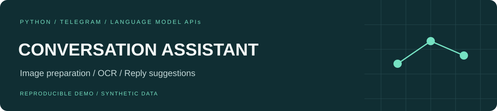
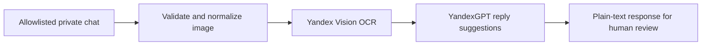

# Conversation Assistant

A private Telegram assistant that turns an image of a conversation into reply suggestions. Python, image preprocessing, OCR and a language-model API form an explicit processing pipeline.



The assistant proposes wording; the user chooses what to send. It never sends a reply to the other participant.

## Try the offline example

Use Python 3.12 in a virtual environment:

```bash
python -m pip install -r requirements.txt
python demo.py
python -m unittest discover -s tests -v
```

The demo runs the real image normalization and pipeline with **invented, fixed OCR and generation responses**. Its image is generated in memory. It sends no requests, requires no keys and does not measure actual OCR or model quality.

Example output:

```text
Friendly: Shall we meet at two?
Flexible: What time works for you?
```

## Run a private bot

Copy `.env.example` to `.env`, supply your own Telegram token, Yandex folder and API key, and put permitted numeric Telegram user IDs in `ALLOWED_USER_IDS`. Set `LIVE_INTEGRATIONS_ENABLED=true`, then run:

```bash
python bot.py
```

`PROXY_URL` is optional. The bot only processes private messages from the allowlist; requests from other users and group chats are ignored. `/start` explains the external data flow. Use synthetic conversations or material you are entitled to share: images go to Yandex Vision and recognized text goes to YandexGPT. Telegram and provider-side retention follow those services' policies.

## Engineering choices

- Inputs are limited to 8 MiB and 20 million pixels. Supported images are decoded and re-encoded as size-limited JPEG, fixing the original PNG/JPEG mismatch and removing image metadata.
- Provider calls use explicit timeouts and refuse redirects. One image is processed at a time; the bot asks later requests to retry.
- Replies are plain text and split into Telegram-sized chunks, so OCR and generated text are never interpreted as HTML.
- No screenshots, recognized conversations, user IDs or provider response bodies are written to application logs. Inputs are held in memory for processing; no application database is used.
- Live requests require explicit configuration. Importing modules does not start polling, create clients or load credentials.

## Code map and validation

`api.py` contains image preparation, provider adapters and orchestration. `bot.py` contains access checks and the Telegram adapter. `demo.py` replays synthetic boundary responses. Tests cover validation, malformed provider responses, failure propagation, transport settings, access checks and plain-text delivery. CI checks installation, tests and the offline demo on Linux and Windows.

Provider payloads follow the official [Vision OCR reference](https://aistudio.yandex.ru/en/docs/vision/ocr/api-ref/TextRecognition/recognize) and [text completion reference](https://aistudio.yandex.ru/en/docs/ai-studio/text-generation/api-ref/TextGeneration/completion).

This is an API-integration prototype, not a trained or evaluated language model. Automated checks use simulated services; live Telegram/Yandex operation and model quality have not been verified for this edition. It has no distributed queue, persistent rate limiter or multi-instance coordination. The Russian prompt and bot messages are retained; this guide is in English.
